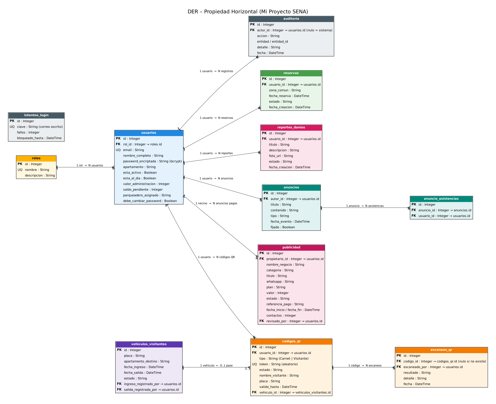

# Diagrama Entidad-Relación (DER)

Versión en Mermaid (GitHub la dibuja automáticamente):

```mermaid
erDiagram
    ROLES ||--o{ USUARIOS : "tiene"
    USUARIOS ||--o{ RESERVAS : "solicita"
    USUARIOS ||--o{ REPORTES_DANIOS : "reporta"
    USUARIOS ||--o{ ANUNCIOS : "publica"
    ANUNCIOS ||--o{ ANUNCIO_ASISTENCIAS : "tiene"
    USUARIOS ||--o{ CODIGOS_QR : "es dueño de"
    CODIGOS_QR ||--o{ ESCANEOS_QR : "se escanea en"
    USUARIOS ||--o{ ESCANEOS_QR : "escanea (guardia)"
    VEHICULOS_VISITANTES ||--o| CODIGOS_QR : "nace de un pase"
    USUARIOS ||--o{ PUBLICIDAD : "anuncia"
    USUARIOS ||--o{ AUDITORIA : "actúa en"
    USUARIOS ||--o{ VISITANTES_AUTORIZADOS : "autoriza"
    VISITANTES_AUTORIZADOS ||--o{ ACCESOS_VISITANTES : "ingresa"
    USUARIOS ||--o{ ACCESOS_VISITANTES : "registra (guardia)"
    USUARIOS ||--o{ PAQUETES : "recibe"
    USUARIOS ||--o{ PAQUETES : "registra y entrega (guardia)"
    USUARIOS ||--o{ NOTIFICACIONES : "recibe"
    USUARIOS ||--o{ PAGOS : "paga"
    USUARIOS ||--o{ PQRS : "radica"
    USUARIOS ||--o{ PQRS : "responde (admin)"
    USUARIOS ||--o{ DOCUMENTOS : "sube (admin)"

    ROLES {
        int id PK
        string nombre UK "Administrador | Residente | Guardia"
        string descripcion
    }
    USUARIOS {
        int id PK
        int rol_id FK
        string email UK
        string nombre_completo
        string password_encriptada "hash bcrypt"
        string apartamento
        bool esta_activo
        bool esta_al_dia
        int valor_administracion
        int saldo_pendiente
        string parqueadero_asignado
    }
    RESERVAS {
        int id PK
        int usuario_id FK
        string zona_comun
        datetime fecha_reserva
        string estado "Pendiente | Aprobada | Cancelada"
        datetime fecha_creacion
    }
    REPORTES_DANIOS {
        int id PK
        int usuario_id FK
        string titulo
        string descripcion
        string foto_url
        string estado "Abierto | En Revision | En Reparacion | Solucionado"
        datetime fecha_creacion
    }
    VEHICULOS_VISITANTES {
        int id PK
        string placa
        string apartamento_destino
        datetime fecha_ingreso
        datetime fecha_salida
        string estado "Dentro | Salido"
        int ingreso_registrado_por FK
        int salida_registrada_por FK
    }
    ANUNCIOS {
        int id PK
        int autor_id FK
        string titulo
        string contenido
        string tipo "Reunion | Evento | Aviso | Urgente | Mantenimiento"
        datetime fecha_evento
        bool fijado
    }
    ANUNCIO_ASISTENCIAS {
        int id PK
        int anuncio_id FK
        int usuario_id FK
    }
    CODIGOS_QR {
        int id PK
        int usuario_id FK
        string tipo "Carnet | Visitante"
        string token UK "aleatorio, 192 bits"
        string estado "Activo | Dentro | Usado | Revocado"
        string nombre_visitante
        string placa
        datetime valido_hasta
        int vehiculo_id FK
    }
    ESCANEOS_QR {
        int id PK
        int codigo_id FK "NULL si el código no existe"
        int escaneado_por FK
        string resultado
        string detalle
        datetime fecha
    }
    AUDITORIA {
        int id PK
        int actor_id FK "NULL = sistema"
        string accion
        string entidad
        int entidad_id
        string detalle
        datetime fecha
    }
    INTENTOS_LOGIN {
        int id PK
        string clave UK "correo escrito"
        int fallos
        datetime bloqueado_hasta
    }
    VISITANTES_AUTORIZADOS {
        int id PK
        int usuario_id FK "residente que autoriza"
        string nombre
        string documento "UK junto con usuario_id"
        string tipo "Familiar | Amigo | Servicio domestico | Cuidador | Contratista | Otro"
        datetime vigente_hasta "NULL = sin vencimiento"
        string notas
        bool activo "false = retirado, se conserva el historial"
    }
    ACCESOS_VISITANTES {
        int id PK
        int visitante_id FK
        datetime fecha_ingreso
        datetime fecha_salida
        int ingreso_registrado_por FK
        int salida_registrada_por FK
    }
    PAQUETES {
        int id PK
        int destinatario_id FK
        string tipo "Paquete | Correspondencia | Domicilio"
        string remitente
        string descripcion
        string estado "En porteria | Entregado | Anulado"
        int recibido_por FK
        datetime fecha_recepcion
        string entregado_a
        int entregado_por FK
        datetime fecha_entrega
    }
    PAGOS {
        int id PK
        int usuario_id FK
        int valor
        int saldo_anterior
        int saldo_posterior
        datetime fecha
    }
    NOTIFICACIONES {
        int id PK
        int usuario_id FK
        string titulo
        string mensaje
        string enlace "ruta de la app, ej. #/paquetes"
        bool leida
        datetime fecha
    }
    PQRS {
        int id PK
        int usuario_id FK "quien radica"
        string tipo "Peticion | Queja | Reclamo | Sugerencia"
        string asunto
        string descripcion
        string estado "Radicada | En tramite | Resuelta | Cerrada"
        string respuesta
        int respondido_por FK
        datetime fecha_respuesta
        datetime fecha_creacion
    }
    DOCUMENTOS {
        int id PK
        string titulo
        string categoria "Reglamento | Acta | Circular | Financiero | Otros"
        string descripcion
        string archivo "nombre aleatorio en uploads/documentos"
        string nombre_original
        int tamano "bytes"
        int subido_por FK
    }
    CONTACTOS_EMERGENCIA {
        int id PK
        string nombre
        string telefono
        string categoria "Emergencias | Salud | Seguridad | Servicios publicos | Administracion | Otros"
        string descripcion
        int orden
    }
    PUBLICIDAD {
        int id PK
        int propietario_id FK
        string nombre_negocio
        string categoria
        string titulo
        string whatsapp
        string plan "Semanal | Mensual | Trimestral"
        int valor
        string estado "Pendiente de pago | En revision | Activa | Rechazada | Vencida"
        string referencia_pago
        datetime fecha_inicio
        datetime fecha_fin
        int contactos
        int revisado_por FK
    }
```

## Relaciones
- **roles → usuarios** (1 a N): cada usuario tiene exactamente un rol; un rol lo comparten muchos usuarios. Es la base del control de acceso (RBAC).
- **usuarios → reservas** (1 a N): un usuario puede hacer muchas reservas.
- **usuarios → reportes_danios** (1 a N): un usuario puede reportar muchos daños.
- **vehiculos_visitantes**: guarda el apartamento de destino como texto, porque los visitantes no son usuarios del sistema; las llaves `ingreso_registrado_por` y `salida_registrada_por` apuntan al personal que registró cada movimiento.
- **usuarios → codigos_qr** (1 a N): un usuario tiene un carnet vigente y varios pases de visitante. Un pase usado enlaza con el `vehiculos_visitantes` que creó (`vehiculo_id`).
- **codigos_qr → escaneos_qr** (1 a N): bitácora de cada lectura; `codigo_id` es nulo cuando el código no existe (intento de falsificación).
- **usuarios → auditoria** (1 a N): cada acción importante guarda quién la hizo; `actor_id` es nulo cuando la causa no tiene sesión (por ejemplo, un bloqueo de login). **intentos_login** no tiene llaves foráneas: cuenta fallos por el correo escrito, exista o no.
- **usuarios → publicidad** (1 a N): un vecino puede tener varios anuncios; `revisado_por` guarda qué administrador confirmó o rechazó el pago.
- **usuarios → visitantes_autorizados** (1 a N): un residente autoriza hasta 20 personas; el par (`usuario_id`, `documento`) es único. Al retirar una autorización solo se marca `activo = false`, para no perder el historial.
- **visitantes_autorizados → accesos_visitantes** (1 a N): cada entrada a pie con su salida y el guardia que registró cada movimiento.
- **usuarios → paquetes** (1 a N): un residente recibe muchos paquetes; `recibido_por` y `entregado_por` apuntan al guardia que los registró y entregó.
- **contactos_emergencia** no tiene llaves foráneas: es un directorio general del conjunto que edita el administrador.
- **usuarios → notificaciones** (1 a N): cada aviso pertenece a una sola persona y solo ella lo ve.
- **usuarios → pqrs** (1 a N): `usuario_id` es quien radica y `respondido_por` el administrador que respondió. El número de radicado (`PQRS-AAAA-0001`) se calcula con el año y el id.
- **usuarios → documentos** (1 a N): `subido_por` es el administrador; el PDF vive en `uploads/documentos/` con nombre aleatorio.
- **usuarios → pagos** (1 a N): cada pago guarda el saldo antes y después y genera un comprobante `REC-AAAA-000123` (se calcula con el año y el id). `usuarios.politica_datos_fecha` guarda cuándo la persona aceptó la política de datos.
